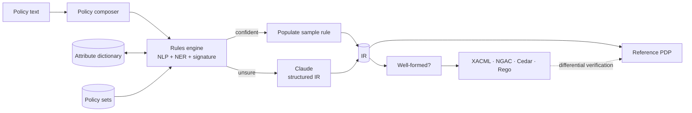

<div align="center">

# raivana

**Write access policy in plain English. Get verified XACML, NGAC, Cedar and Rego.**

[](https://github.com/michaelcgood/raivana/actions/workflows/ci.yml)
[](LICENSE)
[](pyproject.toml)
[](PATENTS.md)

*The reference implementation of US Patent 10,606,957 B1,
"Method and system for translating natural language policy to logical access control policy",
by its inventors Michael Good and Benjamin Coffinberger.*

</div>

---

Access policy starts as English, in a compliance document, a ticket or an email. Someone then
hand-translates it into XACML, Rego, Cedar or an IAM console, and the meaning drifts along the way.
**Raivana closes that gap.** It reads policy text, identifies who, what, which action and under
which conditions, and compiles the result into executable policy for four access control languages.
It then checks its own work.

```text
$ raivana translate "Only doctors can prescribe medication. Nurses may view patient records during
  business hours. Contractors cannot access patient records unless they are on the corporate network."

 #  Policy text                                       Status      Via                     Conf  Rules
 0  Only doctors can prescribe medication.            translated  rules:only-subject      1.00  r1, r2
 1  Nurses may view patient records during ...        translated  rules:permit-condition  1.00  r3
 2  Contractors cannot access patient records ...     translated  rules:deny-unless       1.00  r4, r5

  PERMIT  r1  ALLOW users whose role is doctor to perform prescribe on resources where type is prescription.
  DENY    r2  DENY users whose role is not doctor to perform prescribe on resources where type is prescription.
  PERMIT  r3  ALLOW users whose role is nurse to perform read on resources where type is medical record,
              when the time is at or after 09:00 and the time is before 17:00.
  DENY    r4  DENY users whose employment type is contractor to perform any action on resources where
              type is medical record, when network is not corporate.
  PERMIT  r5  ALLOW users whose employment type is contractor to perform any action on resources where
              type is medical record, when network is corporate.

  overlap r3 (Permit) and r4 (Deny) constrain different attributes but both apply to a request like
          the example; r4 wins under deny-overrides.
```

```cedar
// DENY users whose role is not doctor to perform prescribe on resources where type is prescription.
// Source: Only doctors can prescribe medication.
@id("r2")
forbid (principal, action == Action::"prescribe", resource)
when {
  !(principal has role && principal.role == "doctor") &&
  (resource has type && resource.type == "prescription")
};
```

## Why Raivana is different

- **Four targets from one source of truth.** Output is [XACML 3.0](examples/hospital/hospital.xml),
  [NGAC](examples/hospital/hospital.pml), [Cedar](examples/hospital/hospital.cedar) and
  [Rego / OPA](examples/hospital/hospital.rego), all compiled from one validated intermediate representation.
- **The AI never writes policy code.** Claude produces a small, schema-validated IR. The code is generated
  deterministically, so it is syntactically valid by construction, and LLM costs stay low.
- **Works offline and free.** A purpose-built NLP engine (the patent's method) handles everyday policy
  language with no API key. Hybrid mode sends Claude only the sentences that engine can't handle confidently.
- **It proves its output.** `raivana verify` sends hundreds of randomised access requests through the
  real **Cedar** engine and **OPA**, and checks that every decision matches the reference decision point.
- **It finds policy bugs.** Raivana flags conflicts, redundant and unreachable rules and impossible conditions.
  Each finding comes with a concrete example request that triggers it.
- **A reviewer stays in the loop.** Every rule has a plain-English back-translation and a confidence score.
  A reviewer can accept or reject each translation. Rejecting one tries the next-best interpretation.
- **Built for AI agents.** The MCP server lets Claude and other agents write, test and analyse
  access policy as tools.

## Quickstart

```bash
pip install "raivana[all]"        # or: git clone ... && pip install -e ".[all]"

raivana demo                      # end-to-end showcase, offline
raivana translate -f policy.txt -o out/          # writes .xml .pml .cedar .rego .raivana.json
raivana test out/policy.raivana.json -s role=nurse -a read -R type=medical_record -E hour=22
raivana check out/policy.raivana.json            # conflicts, redundancy, validation
raivana verify out/policy.raivana.json           # differential check vs Cedar / OPA
raivana serve                                    # web UI at http://127.0.0.1:8000
```

> Need Raivana connected to SailPoint, Entra ID, Okta or AWS IAM? See
> [Enterprise implementation](#enterprise-implementation---vector-access-group).

To use the Claude engine, set `ANTHROPIC_API_KEY`. The default engine is `auto`: it runs in hybrid mode
when a key is present and offline otherwise.

## Engines and cost

| Engine | What it does | Cost |
|---|---|---|
| `rules` | Offline NLP: tokenisation, lemmatisation, POS tagging, morphological segmentation, dictionary NER and sample-rule matching | **$0** |
| `hybrid` | Offline first. Sentences that are low-confidence or need new vocabulary go to Claude in **one** batched request | only the hard sentences |
| `claude` | Every sentence goes to Claude, which returns structured IR | ~$0.005 per sentence (Sonnet 5.5) |

The default model is **Claude Sonnet 5.5**. Model routing is configurable:

```bash
raivana translate -f p.txt --model opus          # haiku | sonnet | opus | fable | any model id
raivana translate -f p.txt --route auto          # Haiku for simple text, Sonnet for normal, Opus for complex
raivana translate -f p.txt --provider bedrock    # anthropic | bedrock | vertex | foundry
```

If Claude's output fails validation, Raivana retries once on Opus. The system prompt (instructions,
attribute dictionary and policy-set examples) is byte-stable and prompt-cached, so repeat calls pay about
5% for it. In our runs, a 3-sentence policy cost **$0.009** on Sonnet 5.5, with 7.8k cached prompt tokens.

## Accuracy

The behavioural eval suite has 35 policies and 69 access decisions. It grades the generated policy's
**decisions**, not its text: a translation passes when every check request gets the right answer.

| Engine | Policies fully correct | Decisions correct | Cost of full run |
|---|---|---|---|
| `rules` (offline) | 33 / 35 | 67 / 69 (97.1%) | $0 |
| `claude` (Sonnet 5.5) | 35 / 35 | 69 / 69 (100%) | $0.19 |
| `hybrid` (rules + Sonnet 5.5) | 35 / 35 | 69 / 69 (100%) | **$0.018** |

Run it yourself with `raivana eval --engine rules|hybrid|claude`. The suite includes deliberately informal
"hard" phrasing such as *"Interns should keep their hands off production databases, full stop."* Hybrid
mode matches Claude-only accuracy at about a tenth of the cost, because the offline engine handles 30 of the 35
policies for free. The suite is small and written by the project authors, so treat it as a regression
benchmark, not an independent measurement. Contributions of real-world cases are very welcome.

## How it works



1. **Rule identification** (patent FIG. 2). Detect the language and policy type (healthcare, finance,
   cloud and so on), select the matching *policy sets*, and split the text into candidate rules, including
   "X can A **but** cannot B" clauses.
2. **NLP and NER.** Each sentence is tokenised, lemmatised, POS-tagged and morphologically segmented
   (so "*non*-employees" and "*un*managed devices" are read as negations). Entities are recognised against
   the *attribute dictionary*. Time windows, monetary limits and relations such as "their own" or "in
   their department" are parsed into conditions.
3. **Learning.** Unknown subjects, resources and actions become *candidate attributes* and are stored
   in the dictionary (patent claim 1). For example, "Pharmacy technicians…" teaches `role=pharmacy_technician`.
4. **Matching.** The sentence's semantic signature (e.g. `ONLY_SUBJ SUBJECT PERMIT ACTION RESOURCE`) is
   matched against sample rules. The best match above the confidence threshold is populated with
   the attributes. Negations are expanded using De Morgan's law.
5. **Well-formedness.** Types, operators, categories and satisfiability are checked before any code exists.
6. **Generation, analysis and review.** The IR is compiled to each target. Rules are explained in plain
   English, checked for conflicts, and confirmed by a reviewer.

See [docs/architecture.md](docs/architecture.md) and the claim-by-claim
[patent-to-code map](docs/patent-mapping.md).

## What it understands

| Phrasing | Example |
|---|---|
| Permissions and prohibitions | *Managers can approve expense reports.* / *Contractors cannot delete source code.* |
| Exclusivity | *Only doctors can prescribe medication.* / *Payroll data is restricted to HR staff.* |
| Exceptions | *…unless the amount exceeds $10,000.* / *…except contractors.* / *…without MFA.* |
| Requirements | *Administrators must use MFA to access production servers.* |
| Time | *during business hours*, *between 10pm and 6am* (overnight), *after 8pm*, *on weekends* |
| Thresholds | *payments up to $5,000*, *clearance level 3 or higher* |
| Relations | *their own profiles*, *patients in their department*, *assigned to them* |
| Passive voice | *Medical records can only be viewed by doctors and nurses.* |
| Defaults | *All other access is denied.* / *Deny by default.* |
| Compound | *Billing staff can view billing records but cannot view medical records.* |

Phrasing outside these patterns, other languages and informal text are handled by the Claude engine.

## Interfaces

**Python**

```python
import raivana

result = raivana.translate(open("policy.txt").read(), formats=["cedar", "rego"], engine="hybrid")
print(result.artifacts["rego"].content)
for finding in result.findings:
    print(finding.kind, finding.message, finding.witness)

decision = raivana.evaluate(result.policy, {
    "subject": {"role": "nurse"}, "action": "read",
    "resource": {"type": "medical_record"}, "environment": {"hour": 22},
})
print(decision.decision, decision.reason)
```

**REST API.** Run `raivana serve` and open `/docs` for the interactive OpenAPI page. Endpoints:
`/api/translate`, `/api/evaluate`, `/api/analyze`, `/api/generate`, `/api/verify`, `/api/archive`
and `/api/sessions/{id}/reject|remove` for the review loop. If you deploy beyond localhost, set
`RAIVANA_SERVER_TOKEN`. `RAIVANA_DISABLE_LLM=1` forces the free engine.

**Web UI.** `raivana serve` serves a single-page app with entity highlighting, rule cards that can be
rejected or removed, code tabs with download, an NGAC graph view, an analysis panel and an interactive
policy tester.

**MCP server.** This gives AI agents IAM superpowers:

```bash
claude mcp add raivana -- raivana mcp
```

Tools: `translate_policy`, `evaluate_access`, `analyze_policy`, `generate_policy_code` and `list_vocabulary`.

## Make it yours

Extend the vocabulary with YAML. You don't need to change any code.

```yaml
# my-org.yaml
domain: acme
keywords: [widget, factory]
attributes:
  - id: role
    category: subject
    values:
      line_supervisor: [line supervisor, shift lead]
  - id: type
    category: resource
    values:
      work_order: [work order, wo]
actions:
  release: [release, sign out]
```

```bash
raivana translate -f policy.txt --dictionary my-org.yaml --policy-set my-patterns/
raivana dict add role safety_officer "safety officer, ehs officer"     # saved to ~/.raivana/dictionary.yaml
raivana translate -f policy.txt --save-learned                         # keep vocabulary Raivana learned
```

Domain packs ship for **healthcare**, **finance** and **cloud** on top of a core organisational vocabulary.

## Honest limitations

- The offline engine is English-only and targets the policy register shown above. Free-form prose
  belongs in `hybrid` or `claude` mode.
- NGAC has no native notion of time, numeric thresholds or negated subjects. Raivana reports these
  conditions for enforcement at the PEP and does not drop them silently.
- Cedar always uses forbid-overrides with default deny. Policies that need another combining algorithm
  are flagged.
- Generated policy is a draft for expert review, not a substitute for it.

## Enterprise implementation - Vector Access Group

Raivana is free and open source. Turning it into a governed, production policy pipeline for your
organisation is what **[Vector Access Group](https://vectoraccessgroup.com)**, the inventors'
consultancy, does:

- **Connectors** that deploy generated policy to, and read deployed policy from, **SailPoint**,
  **Microsoft Entra ID**, **Okta**, **Ping** and **AWS IAM / Verified Permissions**
- **Policy drift detection**: continuously compare what your written policy says with what is
  actually deployed
- **Compliance packs** for HIPAA, SOX, PCI DSS and SOC 2, with control mapping and audit evidence
- **Your vocabulary and your rules**: custom dictionaries, policy sets and evaluation suites built from
  your own policies, so translation accuracy is measured on your text
- **Policy lifecycle**: approval workflows, versioning, sign-off and supported deployments with SLAs

**Talk to the inventors:** [michael@vectoraccessgroup.com](mailto:michael@vectoraccessgroup.com?subject=Raivana%20enterprise)
· [vectoraccessgroup.com](https://vectoraccessgroup.com)

## About

Raivana was created by **Michael Good** and **Benjamin Coffinberger**, the inventors of
[US 10,606,957 B1](https://patents.google.com/patent/US10606957B1/en). They filed it in 2019, years
before LLMs made natural-language policy mainstream. This project brings that method to the modern
IAM stack. See [PATENTS.md](PATENTS.md) for how the patent and the license interact.

Licensed under the [Apache License 2.0](LICENSE). "Raivana" is a trademark of its authors; see
[TRADEMARKS.md](TRADEMARKS.md).
