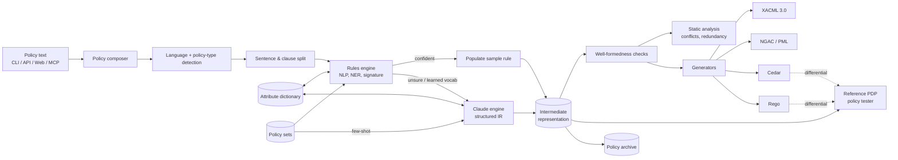

# Architecture

## Design principles

1. **The language model never writes policy code.** Engines produce a small, typed
   intermediate representation (IR, `ir.py`). Generators compile the IR deterministically.
   This makes output well-formed by construction, keeps LLM output tokens (the expensive part)
   small, and lets the same IR target any policy language.

2. **One semantics, checked everywhere.** The reference PDP (`analysis.evaluate`) defines the meaning
   of the IR, including missing-attribute behaviour and multi-valued attributes. Every generator
   is written to match it, and `verify.py` checks that agreement by fuzzing the real Cedar engine
   and OPA.

3. **Offline first, AI where it pays.** The rules engine handles the regular register of policy
   language at zero cost. In hybrid mode, only sentences it can't handle confidently are batched into a
   single Claude request. The system prompt (instructions, dictionary, and policy-set examples) is
   frozen per engine instance and marked for prompt caching.

4. **Explainability.** Every rule has a plain-English back-translation, a source sentence, a confidence,
   and the sample rule (template) or engine that produced it. Every finding carries a concrete
   example request.

## IR semantics

| Construct | Meaning |
|---|---|
| `Rule.subject/resource/environment` | Conditions, AND-ed |
| `Rule.actions` | OR-ed; empty = any action |
| `eq`, `in`, `gt`/`gte`/`lt`/`lte` on a missing attribute | false |
| `neq`, `not_in` on a missing attribute | true |
| List-valued request attribute | Matches if any element matches |
| `Condition.value` is an `AttributeRef` | Attribute-to-attribute comparison (e.g. `resource.owner == subject.id`) |
| `Policy.combining` | deny-overrides (default), permit-overrides, first-applicable, deny-unless-permit, permit-unless-deny |
| `Policy.default_effect` | Decision when no rule applies (from "everything else is denied"-style sentences) |

## Target-language notes

| Target | Notes |
|---|---|
| XACML 3.0 | Equalities go into `<Target>` matches. Negations use `not(is-in)`, ordering uses `any-of`, and relations use `at-least-one-member-of`. The default effect becomes the enclosing PolicySet combining algorithm. |
| Cedar | Every attribute access is guarded with `has`. Cedar is always forbid-overrides with default deny, so other algorithms are flagged in the output. |
| Rego | Self-contained module with `decision`, `allow` and `reasons`. Helper functions handle list-valued attributes. All five combining algorithms are supported, including `first-applicable` through `else` chains. |
| NGAC | Equalities become user and object attributes, Permit becomes an association and Deny becomes a prohibition. Environment conditions, numeric thresholds and negated subjects are reported for enforcement outside the graph (obligations / PEP). |
